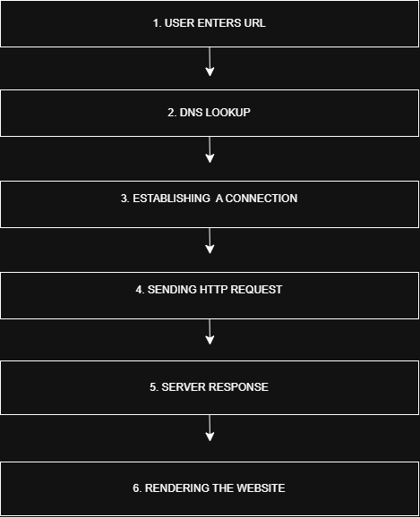

# Part A - Trace a URL

## A1. DNS Lookup

Website: https://www.dorsu.edu.ph

Command used:

```bash
nslookup www.dorsu.edu.ph
```


Output:


```text
Server: UnKnown
Address: fe80::1

Non-authoritative answer:
Name:   www.dorsu.edu.ph
Addresses: 2606:4700:3036::6815:1e68
           2606:4700:3036::ac43:acbf
           172.67.172.191
           104.21.30.104
```

## A2. Understanding the DNS Result

1. What does fe80::1 represent?

fe80::1 is the IPv6 address of the DNS server used by my computer to look up website addresses.

2. Why does the result say "Non-authoritative answer"?

It means the DNS information was provided by a DNS resolver or cache instead of directly by the website's authoritative DNS server.

3. Why are there multiple IP addresses?

The website has multiple IP addresses to help handle visitors, distributive traffic, and keep the website accessible.

## A3. URL Breakdown

1. Protocol: HTTPS

HTTPS stands for Hypertext Transfer Protocol Secure. It allows the browser and website to communicate securely.

2. Subdomain: www

The subdomain is an additional part of the website address. The www is commonly used for the main website.

3. Domain Name: dorsu

The domain name identifies the website and helps users find it on the internet.

4. Domain Extension: .edu

The .edu extension indicates that the website is related to an educational institution.

5. Country Code: .ph

The .ph extension represents the Philippines and identifies the website's country-code domain.

## ## A4. How a URL Works

1. User enters the URL.

The process starts when the user types a website address into the browser and presses Enter.

2. DNS Lookup.

The browser uses DNS to find the IP address of the website. DNS translates the domain name into an IP address.

3. Establishing a Connection.

After finding the IP address, the browser connects to the website's server. Since the website uses HTTPS, it establishes a secure connection.

4. Sending an HTTP Request.

The browser sends an HTTP request to the server to ask for the website's content.

5. Server Response.

The server processes the request and sends the needed website files, such as HTML, CSS, and JavaScript, back to the browser.

6. Rendering the Website.

The browser processes the received files and displays the website. HTML provides the structure, CSS controls the design, and JavaScript adds functionality.

## A5. URL Trace Diagram

